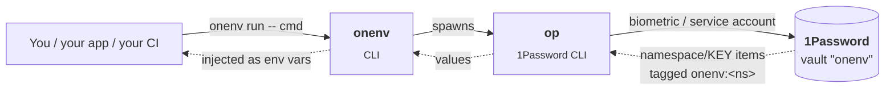

# onenv

> Stop committing `.env`. Stop pasting tokens in Slack. Put your environment
> variables in 1Password and pretend nothing changed.

`onenv` is a small CLI that swaps `.env` files for items in a 1Password vault.
You work the same way you always have — `KEY=value` reads from
`process.env.KEY` — but the values live in your vault, you rotate them in one
place, and you never check a secret into git again.

```bash
onenv set aws AWS_ACCESS_KEY_ID         # masked prompt, value lands in 1Password
onenv run -- node app.js                # injects every secret your project needs, then execs
onenv check                             # diff your shell against the vault — no values printed
```

## Why you might want it

`.env` files were a fine idea ten years ago. Today they sit unencrypted next
to source, drift between three of your laptops, get pasted into chat when you
onboard a new teammate, and nobody ever rotates them.

onenv keeps the `KEY=value` ergonomics — your app code does not change. But
the values live in 1Password:

- **Nothing on disk.** `onenv run` injects secrets into a child process's env
  and they vanish when it exits.
- **Real auth.** Touch ID for you, a scoped service account for CI.
- **Audited.** 1Password tracks every read. Rotate by overwriting the item; no
  redeploy, no edits to a `.env` file on your colleague's laptop.
- **Per-project scope.** A `.onenv.json` checked into each project declares
  which namespaces it pulls. Your frontend never sees backend keys.
- **Agent-friendly.** Run `onenv prime` and pipe the output into your LLM's
  context — it gets every command, flag, error code, and state file in one
  shot, so it stops guessing.

## Install

You need [Bun](https://bun.sh), the [1Password CLI](https://developer.1password.com/docs/cli/), and the 1Password desktop app for biometric unlock.

```bash
brew install 1password-cli bun
op signin
op vault create onenv

git clone https://github.com/doublej/onenv && cd onenv
bun install.ts          # interactive setup — builds the CLI, links it, optionally imports your .env files
```

After the installer finishes, `onenv` is on your PATH.

## A 60-second tour

```bash
# Add a secret. Masked prompt — value never enters shell history.
onenv set aws AWS_ACCESS_KEY_ID
onenv set aws AWS_SECRET_ACCESS_KEY

# Tell this project which namespaces it uses. Writes .onenv.json — commit it.
cd my-app
onenv init

# Run anything with the secrets injected. No `source .env`, no leaks.
onenv run -- node app.js
onenv run -- python manage.py migrate
onenv run -- bun start

# Migrating from another secret store? Pipe the value in — no shell history.
op read "op://Private/aws/credential" | onenv set aws AWS_SECRET_ACCESS_KEY --value-stdin
pbpaste                                | onenv set stripe STRIPE_SECRET_KEY --value-stdin

# Did your laptop's exported env drift from the vault? Find out without leaking values.
onenv check
onenv get aws AWS_SECRET_ACCESS_KEY --fingerprint
# sha256:f5a1e2...

# Retiring a key? `disable` keeps it in 1Password (and recoverable);
# `unset` deletes the item. unset refuses scripted use without --yes.
onenv disable aws AWS_OLD_KEY
onenv unset  aws AWS_OLD_KEY --yes
```

## How it works



Each secret is a 1Password item titled `namespace/KEY` (e.g. `aws/AWS_REGION`)
tagged `onenv:<namespace>`. The `onenv:` tag prefix is how the CLI knows the
item belongs to it, so your vault can hold other unrelated items without
conflict. State (which keys you've disabled) lives at
`~/.config/onenv-manager/state.json`. Everything else is in 1Password.

## JSON files (GCP service accounts, OAuth tokens, kubeconfigs)

Some tools want a path to a JSON file, not env vars. Import the JSON once,
store every leaf as a separate `onenv` key (so each one is individually
auditable and rotatable), and rebuild on demand:

```bash
onenv import google /tmp/sa.json --group sa     # one onenv key per JSON leaf
onenv list google --groups                      # see the sa group's keys
onenv build-file google --group sa              # rebuild the original JSON to stdout
onenv run --file sa:GOOGLE_APPLICATION_CREDENTIALS -- python app.py
# tempfile lives under XDG_RUNTIME_DIR with mode 0600 and is removed on child exit
```

For files the child program mutates (OAuth tokens that self-refresh, rotating
credentials), use `--file-rw` instead of `--file`. onenv hashes the
materialized file before the child runs and re-imports it on clean exit only
if the hash changed. Writeback is skipped on `SIGINT` / `SIGTERM` and on any
read error, so a crashed child can't poison the vault.

If the same group name lives in multiple project namespaces (e.g. one `token`
group per OAuth account), disambiguate with `namespace/group:VAR`:

```bash
onenv run \
  --file-rw gws-poolsuite/token:GMAIL_TOKEN_POOLSUITE \
  --file-rw gws-personal/token:GMAIL_TOKEN_PERSONAL \
  -- python3 mail_sync.py
```

## Common commands

```bash
onenv list                                # all namespaces in your vault
onenv list aws                            # keys in one namespace
onenv list aws --groups                   # bucket keys by reassembly group

onenv set    <ns> <KEY>                   # interactive prompt
onenv set    <ns> <KEY> --value-stdin     # read value from a pipe (no shell history)
onenv edit   <ns> <KEY>                   # same, but errors if the key doesn't exist
onenv get    <ns> <KEY>                   # print the value
onenv get    <ns> <KEY> --fingerprint     # print sha256:<hex>, never the value
onenv unset  <ns> <KEY> [--yes]           # delete (prompts in TTY, requires --yes otherwise)
onenv disable <ns> <KEY>                  # hide from run/export without deleting
onenv enable  <ns> <KEY>                  # restore

onenv init                                # write .onenv.json for the current project
onenv check                               # diff process.env against the vault (no values printed)
onenv run    -- <cmd>                     # run cmd with project secrets injected
onenv export <ns[,ns2]> -- <cmd>          # run cmd with the listed namespaces injected
onenv export <ns[,ns2]>                   # print enabled values as JSON

onenv import <ns> <file.json> --group <name>  # flatten a JSON file into onenv keys
onenv import <ns> --group <name> --from-stdin # same, but read JSON from stdin
onenv import <ns> <file.json> --group <name> --overwrite  # atomic replace (snapshot + rollback)
onenv build-file <ns> --group <name>      # reassemble the JSON from stored leaves

onenv prime                               # full agent primer (XML / Markdown / JSON)
onenv tui                                 # interactive TUI
```

`@1`, `@2`, `@last` work anywhere a namespace is expected — they index into
the most recent list you saw.

Pipe any command (or pass `--json`) and you get a machine-readable JSON
shape, including a structured error envelope with codes, categories, and a
retryable flag.

## Running unattended (CI, daemons)

Use a 1Password service account so `op` skips biometric unlock entirely.

```bash
# 1Password web → Developer → Service Accounts → Create
# Grant read+write on the onenv vault, then either:
export OP_SERVICE_ACCOUNT_TOKEN=ops_eyJ...                          # literal
# or
export OP_SERVICE_ACCOUNT_TOKEN=op://Personal/<id>/credential       # 1Password reference
```

Either form works. The reference variant resolves on first use and caches
the literal at `~/.config/onenv-manager/op-token` (mode 0600); rotating
the token self-invalidates the cache.

Full setup: [`docs/guides/service-account-setup.md`](docs/guides/service-account-setup.md).
CI patterns: [`docs/guides/ci-and-deploys.md`](docs/guides/ci-and-deploys.md).

## Docs

- [Install guide](INSTALL.md) — full setup, env vars, prerequisites
- [Guides](docs/guides/) — migrating from `.env`, per-project setup, CI, service accounts, rotation, multi-env
- [`docs/CLAUDE-onenv.md`](docs/CLAUDE-onenv.md) — drop-in `CLAUDE.md` snippet for projects that use onenv

## Stack

TypeScript, Bun, Commander, @clack/prompts, Biome, Vitest.

## License

[MIT](LICENSE)
